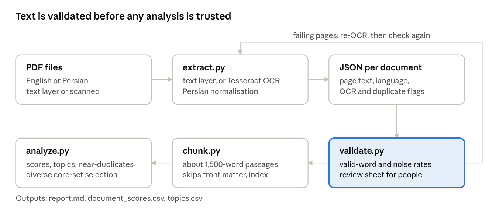

# CulturaMind — Extraction Pipeline & Validation Report

October 16, 2026 · Markdown copy of the [live report](https://claude.ai/code/artifact/48f340db-4a80-4f24-8e81-56ef382b4088). Outputs are in [`outputs/zend-avesta/`](../outputs/zend-avesta/).

## Results at a glance

All three Zend-Avesta volumes (1,284 pages, about 343,000 words) now have usable English text. That includes Part I, which the existing Colab notebook returned as an empty file. The extraction is good enough for topic analysis. It is not yet good enough to quote verbatim or to train a model on without cleaning names and footnotes. The passage ranking needs a project brief before its top 20 can be trusted.

- **Part I is a scan with no text layer.** All 382 pages were read with Tesseract OCR in about 5 minutes. Parts II and III already carried an Internet Archive text layer.
- **Body text is 96–97% valid words** in every volume (dictionary words, plus names that recur across the collection). A hand check of 3 random pages found about 1% real word errors in the main text.
- **Errors cluster in three places:** accents in transliterated names are dropped (Gâthas → Gathas), superscript footnote markers become stray characters, and footnotes are read less accurately than the main text.
- **75 pages of Oxford publisher catalogue** at the back of Parts I and III, plus index and transliteration-table pages, were detected and kept out of the analysis.
- **212 passages** of about 1,500 words were scored. The current top 20 takes 9 from Part III, 7 from Part II and 4 from Part I.
- **Without a brief the ranking barely separates passages:** 161 of 212 score within 0.05 of the cut-off, and the top 20 shares only 18–33% of its pages when the passage size changes.

## The pipeline



Four scripts in `pipeline/` run in order. Validation sits between extraction and analysis, because topic and relevance scores computed on garbled text look plausible but are wrong. `chunk.py` is optional: it lets the analysis rank sections of a book instead of whole books.

```
python pipeline/extract.py  <pdf_dir> <out> --txt --ocr eng
python pipeline/validate.py <pdf_dir> <out> --wordlist /usr/share/dict/american-english-large
python pipeline/chunk.py    <out> <passages> --words 1500
python pipeline/analyze.py  <passages> --select 20 [--brief brief.txt]
```

## Extraction results

Every volume clears the automated threshold of 0.85 valid words on body pages; the weakest 5% of pages still score 0.88 or better.

| Volume | Pages | Text source | Body pages | Words extracted | Valid-word rate, body | Weakest 5% of pages | Flagged body pages | Pages removed as non-content |
| --- | --- | --- | --- | --- | --- | --- | --- | --- |
| Part I — Vendidad | 382 | Tesseract OCR, 300 dpi | 323 | 108,505 | 0.969 | 0.915 | 6 | 40 publisher catalogue |
| Part II — Sîrôzahs, Yasts, Nyâyis | 406 | Internet Archive text layer | 359 | 92,188 | 0.963 | 0.876 | 10 | 16 index |
| Part III — Yasna, Visparad, Afrinagan, Gahs | 496 | Internet Archive text layer | 422 | 142,363 | 0.968 | 0.910 | 8 | 35 catalogue, 7 index |

The 24 flagged body pages are mostly transliteration tables (grids of special characters) and the back cover; they are excluded from passages. Word counts include all pages.

**Hand check against the scans.** One random body page per volume, main text only (logged in `outputs/zend-avesta/validation/manual_check.csv`):

| Page (printed) | Words checked | Word errors | Other problems seen |
| --- | --- | --- | --- |
| Part I, p. 149 | ~170 | 0 | “Gâthas” read as “Gathas” twice; stray marks at line starts |
| Part II, p. 246 | ~190 | 2 (“mav”, “1” for “I”) | Footnote markers glued to words (“head’”, “drink?”); footnotes garbled |
| Part III, p. 234 | ~170 | 1 (“ii.” for “11.”) | “Urvâkhshaya”, “Keresâspa” lose their accents; superscript 1 read as “l” |

That is about 3 errors in 530 words, roughly 0.6%, or nearer 2% if lost accents count. I made this check by reading the page images, so it is a first estimate: the sample is too small, and the person-led check in the validation table still needs doing. While checking, I also found and fixed a cleaning bug: words split across lines (“green-/ish”) were not being re-joined.

## Comparison with the Colab notebook

On the two volumes that have a text layer, the notebook (`Txt_extractor.ipynb`, pdfplumber) and the pipeline agree on 97–98% of words, so neither loses text there. The difference is Part I and what happens around the text.

| Volume | Notebook words | Pipeline words | Word overlap |
| --- | --- | --- | --- |
| Part I | 0 (empty file, no error shown) | 108,505 (OCR) | — |
| Part II | 92,945 | 92,188 | 98.1% |
| Part III | 143,589 | 142,363 | 97.5% |

Other differences:

- The notebook writes one `.txt` per book with `Page N` banner lines mixed into the text. The pipeline writes JSON with each page separate, plus language, OCR and duplicate flags, and an optional `.txt` copy.
- The pipeline removes running headers, re-joins words split across lines, and keeps publisher catalogues and index pages out of the analysis.
- The notebook also reads EPUB, LaTeX and JSONL; the pipeline reads only PDF. Keep the notebook's EPUB and LaTeX functions and replace its PDF function with `extract.py`.

## NLP analysis

The analysis found 15 coherent topics that match the books' real structure, but its passage ranking is only a starting list until a project brief is added. Without a brief, scores reward passages typical of the whole collection, and the largest topic is the translator's commentary on the Gâthas, not the sacred texts themselves.

**Topics.** The labels are my reading of each topic's top terms; a subject expert should confirm them (validation row 6).

| Topic | My label | Passages | In top 20 | Top terms |
| --- | --- | --- | --- | --- |
| 1 | Gâthas with translator's commentary | 44 | 5 | mind, verse, pahlavi, good mind, translator |
| 3 | Yasna liturgy: Bountiful Immortals, saints | 23 | 2 | ritual, bountiful immortals, worship, praise |
| 2 | Vendidad law on corpses and dead matter | 21 | 1 | mazda answered, maker material world, dead, dog, corpse |
| 4 | Introductions: Avesta, Zend language, Magi | 20 | 1 | avesta, zend, language, persia, inscriptions, magi |
| 14 | Yast refrain passages | 20 | 1 | brightness glory, sacrifice worth heard |
| 13 | Introductions: Indo-Iranian myth | 14 | 2 | storm, indo iranian, gods, fiends, angra mainyu |
| 11 | Visparad invocations of the lords of the ritual order | 11 | 1 | ritual order, lords, holy lord, announce |
| 8 | Mihir Yast: Mithra | 10 | 1 | unto mithra, sleepless awake, wide pastures |
| 12 | Penalties: stripes with the horse-whip | 9 | 1 | stripes, aspahê astra, penalty, shall pay |
| 0 | Sîrôzah invocations | 8 | 1 | makes world grow, amesha spenta, holiness |
| 5 | Âbân Yast: Ardvi Sûra Anâhita | 8 | 1 | ardvi sura, anahita, grant boon |
| 6 | Spells to drive the fiend away | 8 | 0 | drive away, perish, fiend, airyaman |
| 7 | Farvardin Yast: the Fravashis | 8 | 1 | fravashi, farvardin yast, withstand evil |
| 9 | The soul after death | 7 | 2 | step soul, good thoughts, good words, good deeds |
| 10 | Purification from the Drug Nasu | 4 | 0 | drug nasu, sprinkle, holes |

**Current top 20** (PDF page numbers, not printed ones), chosen for score and topic spread:

| # | Passage | Topic | Score |
| --- | --- | --- | --- |
| 1 | Part III pp. 126–130 | 1 Gâthas commentary | 0.923 |
| 2 | Part III pp. 156–160 | 1 Gâthas commentary | 0.919 |
| 3 | Part III pp. 228–232 | 1 Gâthas commentary | 0.914 |
| 4 | Part III pp. 102–106 | 1 Gâthas commentary | 0.901 |
| 5 | Part III pp. 113–117 | 1 Gâthas commentary | 0.897 |
| 6 | Part III pp. 358–363 | 3 Yasna liturgy | 0.873 |
| 7 | Part II pp. 49–54 | 0 Sîrôzah | 0.862 |
| 8 | Part II pp. 352–357 | 9 Soul after death | 0.857 |
| 9 | Part III pp. 293–298 | 3 Yasna liturgy (Haoma) | 0.851 |
| 10 | Part III pp. 21–25 | 4 Introductions | 0.845 |
| 11 | Part III pp. 437–443 | 11 Visparad, Miscellaneous Fragments | 0.845 |
| 12 | Part II pp. 151–156 | 8 Mithra | 0.839 |
| 13 | Part I pp. 57–60 | 13 Indo-Iranian myth | 0.839 |
| 14 | Part II pp. 335–340 | 9 Soul after death | 0.839 |
| 15 | Part I pp. 85–88 | 13 Indo-Iranian myth | 0.838 |
| 16 | Part II pp. 105–109 | 14 Yast refrains (moon) | 0.836 |
| 17 | Part II pp. 87–92 | 5 Anâhita | 0.836 |
| 18 | Part I pp. 303–307 | 12 Penalties | 0.835 |
| 19 | Part II pp. 212–217 | 7 Fravashis | 0.827 |
| 20 | Part I pp. 122–126 | 2 Vendidad law | 0.796 |

**How far to trust this list.** Scores bunch tightly: 161 of the 212 eligible passages lie within 0.05 of the 20th score. Page-level scores are fairly stable across passage sizes (Spearman 0.81 for 1,000 vs 1,500 words, 0.73 for 2,000 vs 1,500). But the top 20 itself shares only 18% of its pages at 1,000 words, 33% at 2,000, and 60% at diversity 0.5. Treat it as a candidate list for expert review. A project brief, saying which texts and themes the model should learn from, is the change most likely to make it decisive.

## How to validate the results

No score in this pipeline is ground truth: a person comparing text with page images is. Run the checks in this order, because a failure at one level makes everything below it unreliable.

| # | Check | How | Pass threshold | Who |
| --- | --- | --- | --- | --- |
| 1 | Every page accounted for | `extraction_summary.csv`: pages, scanned pages, OCR pages | No body page without text | Automatic |
| 2 | Automated page quality | `validate.py` → `page_quality.csv` | Body pages: valid-word rate ≥ 0.85, noise ≤ 2%; every flagged page looked at | Automatic, then a person |
| 3 | Word error rate (WER) on a sample | `review.html`: 12 random body pages per volume, count wrong or missing words against the image, log in `manual_check.csv` | ≤ 2% for topic analysis; ≤ 0.5% for text quoted or used to train a model | A person who reads the language |
| 4 | Proper names and transliterations | List the 200 most frequent capitalised words; check spellings against the printed index | Each key name has one dominant spelling | Subject expert |
| 5 | Structure | Spot-check: running headers, publisher adverts, index removed; footnotes not merged into sentences | No boilerplate in passages chosen for the core set | A person |
| 6 | Topics make sense | Give each topic's top 10 terms a short label | Every topic can be labelled; none is OCR noise | Subject expert |
| 7 | Selection agrees with experts | Expert picks their own top 10 passages without seeing the ranking | At least 6 of the expert's 10 in the pipeline's top 20 | Subject expert |
| 8 | Ranking is stable | Re-run with passage size 1,000 and 2,000 words and diversity 0.2 and 0.5 | Spearman rank correlation ≥ 0.8 between runs | Automatic |
| 9 | Persian only | Check reading order, ی/ک, joined words (می‌شود) on sample pages | No reversed lines; WER as in row 3 | A Persian reader |

The sample in row 3 is about 4,000 words per volume (12 pages × ~350 words). That pins a 2% error rate to within about ±0.5 points at 95% confidence; check more pages if the result lands near the threshold. Keep `manual_check.csv` in the repository with the outputs, so each later run can be compared with the same yardstick.

## Limitations and open questions

- **Footnotes stay inside the page text.** They are the noisiest part of each page and mix scholarly notes into the translation. Separating them, by their smaller type size, is the next extraction improvement.
- **Accents are lost.** OCR with English-only language data drops â, ê, î, ô, û. That matters if names must match a Persian or Avestan spelling; a Latin-script OCR model with accented letters could be tried on Part I.
- **Persian handling is untested on real books.** It passed tests on generated PDFs only. The first real Persian PDF should go through the same validation, with a Persian reader for row 9.
- **Scoring is word-based** (TF-IDF and topic models). It sees shared vocabulary, not meaning; a meaning-based model would be worth testing once the brief exists.

Open questions:

- What should the model know or do? A few sentences in English and Persian become the brief that drives relevance.
- Should translators' commentary count, or only the translated texts? If only the texts, commentary pages can be filtered out before ranking.
- Should each volume get a fixed share of the core set?
